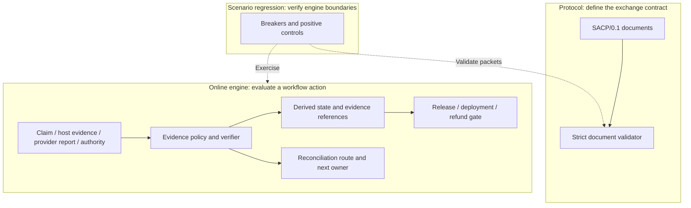

# SACP — Verify AI Agent Completion Claims

[](https://github.com/aDragon0707/sacp/actions/workflows/main-verify.yml?query=branch%3Amain)
[](./docs/development.md)
[](./LICENSE)

**An agent says “done.” Should your workflow continue?**

SACP (Scalable Audit and Control Protocol) makes completion conditions explicit: what the agent claims, which evidence supports it, what an external system reports, and who authorizes the next action. Its Python reference engine derives a verdict that a domain gate uses to allow or block continuation.

**Experimental alpha:** an exchange protocol, executable reference engine and reproducible examples. Trustworthy evidence collection remains an integration responsibility.

[中文](./README.zh-CN.md) · [Quick start](#quick-start) · [Architecture](#architecture) · [PR workflow](#sacp-in-this-repository) · [Example guide](./examples/README.md)

<a id="where-it-helps"></a>

## 🎯 Where it helps

Agent workflows often cross boundaries where similar-looking results mean different things:

| At the handoff | What still needs checking |
|---|---|
| “Tests passed; ready to release.” | Do the test and artifact evidence match this commit, and is this input approved? |
| “The deployment request was accepted.” | Has the provider reported health for the same deployment and revision? |
| “The notification was delivered.” | Is there matching delivery evidence, and has a later bounce changed the result? |
| “The request timed out; retry it.” | Could the effect already have happened, and who owns reconciliation? |

CI supplies execution results, tracing records observations, and workflow engines manage progress. SACP adds explicit evidence requirements, completion rules and recovery ownership at these handoffs. It is most useful when local execution, external completion and authorization differ.

<a id="one-example-release-preflight"></a>

## 🔎 One example: release preflight

An agent wants to publish a release. The gate checks test evidence, artifact identity and approval together:

| Supplied evidence | Gate result | Reason |
|---|---|---|
| Passing CI + matching artifact, no approval | Block | The action is not authorized |
| Same evidence + matching current approval | Allow preflight | Evidence and authorization satisfy the release policy |
| Approval present, artifact from another commit | Block | The evidence does not support this release |

The allowed result means the preflight contract passed. Publishing remains the caller's action.

<a id="quick-start"></a>

## 🚀 Quick start

Use Python **3.11 or 3.12**. Run the example above with local fixtures:

```bash
git clone https://github.com/aDragon0707/sacp.git
cd sacp
python -m pip install -r requirements-ci.txt
python -m examples.github_release_gate
```

The three cases print `allowed=False`, `allowed=True`, then `allowed=False`. They make no GitHub requests and publish nothing.

Then inspect the failure boundaries and valid-success controls:

```bash
python -m sacp_harness
```

```text
Breaker cases blocked: 8/8; false-success allowed: 0
...
Positive controls passed: 3/3

## Protocol validator: 49/49 strict PASS (0 FAIL)
```

This is a **scenario regression harness for the SACP engine**: it constructs claims and mock events directly, without running a coding agent or calling a model. It prints by default; `--output-dir .local/harness` explicitly writes reports. Continue through the [example guide](./examples/README.md) for deployment, refund, recovery and optional LangGraph demos.

The separate **Pi integration** now provides a no-model installation probe, JSON event replay and independent source-test acceptance. Try `python -m examples.pi_evaluation`: a scripted success claim passes for correct code and is blocked for incorrect code. This is not a real-agent benchmark; see the [integration guide](./docs/pi-integration.md) and [ADR-0001](./docs/adr/0001-real-agent-evaluation-with-pi.md).

<a id="architecture"></a>

## 🧩 Architecture

The core path is **Claim → Evidence → Verdict → Gate**. Three layers make it usable and testable:



The engine keeps claims, host observations, provider observations and authority decisions separate. Events are stored through an append-only SQLite API; new evidence can change the derived state without erasing history. Reconciliation records bounded recovery routes for callers to act on.

The runtime `DerivedReceipt` is a Python projection. A `SACP/0.1` wire receipt is a separate exchange document; the CI builder constructs one for repository checks. Neither a valid document nor an approved action proves that an external effect succeeded.

See [architecture](./docs/architecture.md) for component responsibilities and [runtime contracts](./docs/runtime-contracts.md) for identity, authorization and recovery rules.

<a id="sacp-in-this-repository"></a>

## 🔄 SACP in this repository

This repository applies the evidence-bound review pattern to its own pull requests:

```text
PR code → read-only CI → evidence artifacts
        → trusted default-branch checks → SHA-bound SACP receipt
        → maintainer review → manual squash merge → main revalidation
```

The trusted collector independently checks GitHub job results, current PR identity and source fingerprints before receipt construction. Execution-definition changes require maintainer bootstrap review. `COMPLETE / 200` means automated preflight passed for the recorded SHA; maintainers still review semantics and authorize merging.

For a concrete record, [PR #22](https://github.com/aDragon0707/sacp/pull/22) passed preflight and was manually merged; [main verification 38669974026](https://github.com/aDragon0707/sacp/actions/runs/38669974026) then passed on merged commit [`48ba192`](https://github.com/aDragon0707/sacp/commit/48ba19209b7ea6f9d833193f92319cee0eed291a). The [verification record](./docs/verification-2026-10-15.md) also covers failing tests, a new PR SHA, workflow changes and protocol review warnings.

<a id="choose-an-entry-point"></a>

## 🔌 Choose an entry point

| Your goal | Start here |
|---|---|
| Understand or extend the exchange contract | [SACP/0.1 spec](./SPEC.md), [receipt format](./RECEIPT.md) |
| Add evidence checks to a workflow | [Example guide](./examples/README.md), [reference engine](./sacp_verify/), [LangGraph adapter](./sacp_verify/langgraph_adapter.py) |
| Evaluate release, deployment or refund conditions | [Release](./examples/github_release_gate.py), [deployment](./examples/deployment_verification.py), [refund](./examples/refund_agent.py) |
| Audit an existing text response or handoff | [AgentOps Doctor](./agentops-doctor-skill/): local heuristics, without rerunning the task |
| Preserve long-running handoffs | [Receipt Chain](./SACP_RECEIPT_CHAIN.md): optional audit profile |

<a id="verification-and-current-boundaries"></a>

## 🧪 Verification and current boundaries

The linked main run verifies 100 core tests on each of Ubuntu Python 3.11/3.12 and Windows Python 3.12, seven LangGraph tests, 49 strict-valid protocol documents, and eight harness breakers plus three positive controls, with zero failures, errors or skips. These overlapping checks are scoped regression evidence, not independent samples or a production accuracy estimate. `false-success allowed: 0` applies only to the fixed breaker set.

- **Evidence sources:** the Python store does not authenticate writers. Payload adapters require trusted collection and access control from the integration.
- **Execution:** providers are mocked or localhost experiments. Callers own scheduling, real side effects, retries and compensation; there is no hosted service or end-to-end exactly-once guarantee.
- **PR trust:** application code and tests still share a process. Semantic review remains necessary; actual fork E2E coverage is unverified. There is no automated approval, repair or merge.

The base engine uses Python's standard library; protocol/CI tooling requires PyYAML, and LangGraph has explicit optional dependencies. See [STATUS](./STATUS.md), [verification scope](./docs/verification-2026-10-15.md) and [ROADMAP](./ROADMAP.md) for the full boundaries.

<a id="documentation-and-contributing"></a>

## 📚 Documentation and contributing

- **Understand:** [Architecture](./docs/architecture.md) · [Evidence model](./docs/evidence-model.md) · [State projection](./docs/state-machine.md)
- **Evaluation decisions:** [Vocabulary](./GLOSSARY.md) · [ADR-0001: real-agent evaluation with Pi](./docs/adr/0001-real-agent-evaluation-with-pi.md)
- **Run and develop:** [Examples](./examples/README.md) · [Development and suite commands](./docs/development.md) · [Runtime contracts](./docs/runtime-contracts.md)
- **Review and extend:** [Maintainer workflow](./docs/maintainer-workflow.md) · [Dirty Run cases](./DIRTY_RUN_CASES.md) · [Contributing](./CONTRIBUTING.md)

Useful contributions include a reproducible false-completion case, a valid-success case that was incorrectly blocked, an adapter contract test, or a focused documentation correction. Include the expected and actual results, code version and minimal reproduction. Remove secrets, personal data and proprietary logs before submitting examples.

## License

See [LICENSE](./LICENSE).
