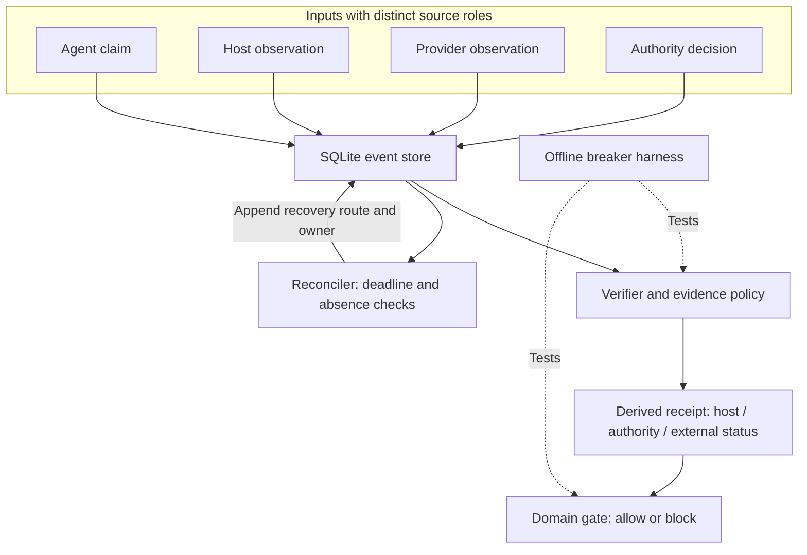

# SACP — Verify AI Agent Completion Claims

**Turn “done” into a claim you can check against evidence.**

SACP (Scalable Audit and Control Protocol) is an experimental audit protocol and reference verification engine for AI agent work. It records what an agent claims, links the available evidence, and derives a status that downstream code can inspect before continuing.

[中文](./README.zh-CN.md) · [Quick start](#quick-start) · [Architecture](#architecture) · [Examples](./examples/README.md) · [Verification](#verification) · [Contributing](#contributing)

## The Problem: What Does “Done” Prove?

```text
Done. All tests passed. Ready to publish.
```

That message combines several conclusions. Each needs its own evidence:

| Claim | What needs checking | Result when evidence is incomplete |
|---|---|---|
| “Tests passed.” | Referenced test or CI observations supporting the claim | `unverified` for the supported test-claim policy |
| “The notification was delivered.” | A provider delivery event; `accepted` only means receipt of the request | `transport_accepted` while only acceptance is reported |
| “The deployment is healthy.” | Health evidence matching the requested revision | Deployment finalization is blocked without matching health |
| “This is approved.” | A current decision matching the input, scope, and execution context | Missing or stale approval prevents an authorized preflight |

SACP separates **claims, observations, and authorization** so a local success or an accepted request does not silently become a stronger business conclusion. Its rules depend on the evidence supplied; trustworthy collection remains an integration responsibility.

## Quick Start

Use Python **3.11 or 3.12**, the versions covered by the configured CI matrix. Run from the repository root:

```bash
git clone https://github.com/aDragon0707/sacp.git
cd sacp
python -m pip install -r requirements-ci.txt
python -m sacp_harness
```

The harness runs eight fixed synthetic breaker cases, three positive controls, then strictly validates the protocol examples and translated receipts. The current baseline prints:

```text
Breaker cases blocked: 8/8; false-success allowed: 0
...
## Protocol validator: 49/49 strict PASS (0 FAIL)
```

For example, S1 supplies a test-success claim without evidence and yields `unverified`; S2 supplies deployment acceptance without health and blocks finalization. These are reproducible boundary checks, not a population-level accuracy estimate. The command only prints by default; reports are written only with an explicit `--output-dir`.

To see both allowed and blocked release decisions using local fixtures:

```bash
python -m examples.github_release_gate
```

The example blocks missing approval, allows matching evidence and approval, and blocks an artifact from another commit. It does not publish a release or call GitHub.

Continue with the [example guide](./examples/README.md) for a learning order, expected results, dependencies, and the distinction between runtime demos and protocol documents.

## Architecture

The runtime follows **Claim → Evidence → Verdict**: record separate inputs, derive a receipt, then apply a domain-specific gate.



| Input | Intended source | Meaning |
|---|---|---|
| `Claim` | Agent | What the agent says happened |
| `HostObservation` | Host runtime or CI collector | Observed execution, test, or artifact data |
| `ProviderObservation` | External-system adapter | What a provider reports: acceptance, delivery, health, failure |
| `AuthorityDecision` | Human or trusted policy | Permission bound to a specific input, scope, context, and expiry |

These source roles are a design contract. The current Python store API does **not** authenticate writers or prevent a caller with write access from fabricating observations.

Three parts work together:

- **Protocol:** [SACP/0.1](./SPEC.md), the [receipt format](./RECEIPT.md), and [validator](./validator.py) define and check exchange documents.
- **Online reference engine:** [sacp_verify/](./sacp_verify/) stores events, derives multi-dimensional state, and exposes release, deployment, and refund gates. A caller invokes the reconciler to record missing attestations and bounded recovery routes.
- **Offline harness:** [sacp_harness/](./sacp_harness/) checks fixed failure scenarios and protocol documents without model calls or live business actions.

The runtime `DerivedReceipt` is a Python projection, not the `SACP/0.1` wire receipt. [CI receipt generation](./scripts/build_ci_receipt.py) constructs the protocol document separately. A CI `COMPLETE / 200` describes automated preflight; human approval, merge, and release authorization remain separate decisions.

## Verification

Reference results for code baseline [`1b76ff3`](https://github.com/aDragon0707/sacp/commit/1b76ff386d6091535aae94acbb7517c9170bd5d8), checked locally on Windows with CPython 3.12.10:

| Suite | Reference result | What it checks |
|---|---|---|
| `core` | 100 tests, zero failures or skips | Engine, gates, adapters, concurrent SQLite recovery/idempotency, and CI tooling contracts |
| `langgraph` | 7 tests, zero failures or skips | Real LangGraph wiring, checkpoint persistence, restart, and localhost HTTP integration |
| `protocol` | 49 documents, strict PASS | Public YAML examples and translated receipts satisfy the validator |
| `harness` | 8/8 breakers and 3/3 positive controls | Failure boundaries plus valid delivery, deployment health, and authorized mock refund |

Reproduce the suites through one entry point. `.local/` is ignored; generated JSON stays out of tracked source files:

```bash
python scripts/run_tests.py --suite core --fail-on-skip --json .local/evidence/core.json
python scripts/run_tests.py --suite protocol --fail-on-skip --json .local/evidence/protocol.json
python scripts/run_tests.py --suite harness --fail-on-skip --json .local/evidence/harness.json

# Optional LangGraph integration
python -m pip install -r requirements-integration.txt
python scripts/run_tests.py --suite langgraph --fail-on-skip --json .local/evidence/langgraph.json
```

CI configures core checks on Ubuntu Python 3.11/3.12 and Windows Python 3.12, plus LangGraph integration on Ubuntu Python 3.12. The local reference results above do not substitute for a particular CI run.

Read the numbers by their scope: protocol validation checks document conformance, and the harness checks a small synthetic set. The harness also invokes protocol validation, so these counts are not independent samples. Its `false_success_allowed` field counts unmet breaker expectations; `0` is not a measured real-world false-success rate. The report's `trace_view` column is explanatory text, not a benchmark of tracing products.

## Integration Paths

| Goal | Starting point | Current scope |
|---|---|---|
| Audit an existing response or handoff | [AgentOps Doctor](./agentops-doctor-skill/) | Local text heuristics; does not execute or independently verify the original task |
| Gate a release | [GitHub fixture example](./examples/github_release_gate.py) and [payload adapter](./sacp_verify/github_actions.py) | Fixture / REST-shaped payload ingestion; not an authenticated GitHub collector |
| Check deployment or refund completion | [Deployment example](./examples/deployment_verification.py), [refund example](./examples/refund_agent.py) | Mock providers and localhost experiments; no production deployment or money movement |
| Add a workflow-engine seam | [LangGraph adapter](./sacp_verify/langgraph_adapter.py) and [tests](./tests/test_langgraph_adapter.py) | Real graph/checkpointer components with synthetic host observations and demo approval inputs |
| Preserve long-running handoffs | [Receipt Chain](./SACP_RECEIPT_CHAIN.md) | Optional audit profile; scheduling remains with the caller |

To audit a text file with Doctor:

```bash
python -X utf8 agentops-doctor-skill/agentops_doctor.py agentops-doctor-skill/examples/unsupported_test_claim.md
```

CI, tracing, and workflow engines remain useful sources of execution data and control. SACP adds explicit evidence requirements, completion conditions, and ownership at the handoff or business gate. For a task already fully covered by one existing CI check, an extra layer may add little value.

## Maturity and Boundaries

**Experimental alpha:** protocol, executable reference engine, deterministic harness, and integration experiments. There is no hosted SACP service or production-correctness guarantee.

- **Evidence trust:** types, references, and digests do not authenticate a producer. Unknown claim types now fail closed; supported lifecycle intentions remain distinct from proven completion.
- **Storage and recovery:** the store API appends events; it is not tamper-proof storage. Deadline checks continue after acceptance and serialize through SQLite. They record routes and owners; callers still supply scheduling, retries and compensation execution.
- **Business semantics:** gates bind completion to one provider receipt and scope. Deployment exposes separate dispatch authorization and health checks. Mock refund keys persist within one SQLite database, including conflict and concurrency checks; this provides no end-to-end exactly-once guarantee. See [runtime contracts](./docs/runtime-contracts.md).
- **PR automation:** trusted default-branch code independently checks GitHub jobs, current PR head, merge parents, source tree and test inventory before issuing receipts. Changed execution definitions require maintainer bootstrap review. Arbitrary PR code and tests still share a process; automated evidence cannot replace semantic review. Real fork end-to-end coverage remains outstanding; see [verification scope](./docs/verification-2026-10-15.md).
- **Dependencies:** the base engine uses Python's standard library, including SQLite. Protocol/CI tooling uses PyYAML; LangGraph integrations need the optional requirements file.

## Read Further

| Question | Entry point |
|---|---|
| What is the exchange contract? | [Spec](./SPEC.md), [Envelope](./ENVELOPE.md), [Receipt](./RECEIPT.md), [Status codes](./STATUS_CODES.md) |
| How is state actually derived? | [Models](./sacp_verify/model.py), [evidence policy](./sacp_verify/policy.py), [verifier](./sacp_verify/verifier.py), [reconciler](./sacp_verify/reconciler.py) |
| How do the components fit together? | [Architecture](./docs/architecture.md), [runtime contracts](./docs/runtime-contracts.md), [development](./docs/development.md) |
| What are the failure cases? | [Executable breakers](./sacp_harness/run.py), [tests](./tests/), [protocol Dirty Run cases](./DIRTY_RUN_CASES.md) |
| How are PRs reviewed? | [Maintainer workflow](./docs/maintainer-workflow.md) and [workflows](./.github/workflows/) |
| What do receipt examples look like? | [Examples](./examples/), [sample corpus](./sample-corpus/), [Receipt Chain](./SACP_RECEIPT_CHAIN.md) |

[STATUS](./STATUS.md) describes current capabilities and [ROADMAP](./ROADMAP.md) separates hardening from future work. Earlier research notes and saved reports are historical evidence, not current test results.

## Contributing

Useful contributions include a reproducible false-completion case, a valid-success case that was incorrectly blocked, an adapter contract test, or a focused documentation correction. Include the expected result, actual result, code version, and a minimal reproduction.

For agent-output samples, remove secrets, personal data, private paths, and proprietary logs before submitting. See [CONTRIBUTING.md](./CONTRIBUTING.md); protocol changes also need compatibility and failure-case review.

## License

See [LICENSE](./LICENSE).
