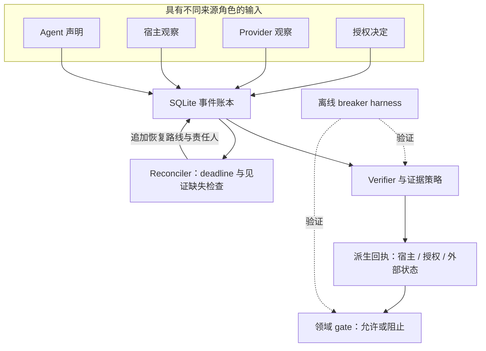

# SACP — AI Agent 完成声明核验

**让“我做完了”对应一份可检查的证据。**

SACP（Scalable Audit and Control Protocol）是一个实验性的审计协议与参考验证引擎，面向 AI Agent 工作。它记录 Agent 声称了什么、关联现有证据，并派生状态，供下游代码在继续执行前检查。

[English](./README.md) · [快速上手](#快速上手) · [架构](#架构) · [示例导航](./examples/README.zh-CN.md) · [验证结果](#验证结果) · [参与贡献](#参与贡献)

## 问题：“完成了”究竟证明了什么？

```text
Done. All tests passed. Ready to publish.
```

这条回复混合了多个结论，每个结论都需要自己的证据：

| 声明 | 需要检查什么 | 证据不足时的结果 |
|---|---|---|
| “测试通过了。” | 声明引用的测试或 CI 观察是否满足判据 | 已支持的测试声明策略下为 `unverified` |
| “通知送达了。” | Provider 的 delivery 事件；`accepted` 只表示请求被接收 | 只有接收记录时保持 `transport_accepted` |
| “部署健康。” | 与目标 revision 匹配的健康证据 | 没有匹配的健康证据就阻止部署最终化 |
| “已经获批。” | 与输入、作用域、执行上下文匹配且有效的决定 | 缺失或过期的批准不能通过授权预检 |

SACP 将**声明、观察和授权**分开，避免把本地成功或请求受理悄悄升级为更强的业务结论。规则依赖输入证据，可信采集仍由接入方负责。

## 快速上手

使用配置中的 CI 矩阵覆盖的 Python **3.11 或 3.12**。在仓库根目录运行：

```bash
git clone https://github.com/aDragon0707/sacp.git
cd sacp
python -m pip install -r requirements-ci.txt
python -m sacp_harness
```

Harness 先运行 8 个固定的合成反例和 3 个正向控制，再严格校验协议示例和转写 receipt。当前基线会输出：

```text
Breaker cases blocked: 8/8; false-success allowed: 0
...
## Protocol validator: 49/49 strict PASS (0 FAIL)
```

例如，S1 提交没有证据的测试成功声明，得到 `unverified`；S2 只有部署 accepted、没有健康证据，会阻止最终化。这些结果证明固定边界可复现，不是总体准确率估计。命令默认只打印；仅在显式传入 `--output-dir` 时写报告。

想看同时包含允许与阻止结果的本地发布预检示例：

```bash
python -m examples.github_release_gate
```

示例会阻止缺少授权、允许证据与授权匹配的预检，并阻止来自其他 commit 的产物。它使用本地 fixture，不发布 release，也不调用 GitHub。

接着阅读[示例导航](./examples/README.zh-CN.md)，查看学习顺序、预期结果、依赖，以及运行时 demo 与协议文档的区别。

## 架构

运行时遵循 **Claim → Evidence → Verdict（声明 → 证据 → 判定）**：分别记录输入，派生 receipt，再由领域 gate 判断是否允许继续。



| 输入 | 预期来源 | 含义 |
|---|---|---|
| `Claim` | Agent | Agent 声称发生了什么 |
| `HostObservation` | 宿主运行时或 CI 采集器 | 观察到的执行、测试或产物数据 |
| `ProviderObservation` | 外部系统 adapter | Provider 报告的受理、交付、健康或失败 |
| `AuthorityDecision` | 人或可信政策 | 绑定特定输入、作用域、上下文和有效期的权限 |

这些来源角色是设计契约。当前 Python store API **没有**认证写入者，也不能阻止具有写权限的调用方伪造观察。

项目由三部分配合：

- **协议：**[SACP/0.1](./SPEC.md)、[receipt 格式](./RECEIPT.md)和 [validator](./validator.py) 定义并校验交换文档。
- **在线参考引擎：**[sacp_verify/](./sacp_verify/) 保存事件、派生多维状态，提供发布、部署和退款 gate。调用方执行 reconciler，以记录缺失见证和有界恢复路线。
- **离线 harness：**[sacp_harness/](./sacp_harness/) 验证固定失败场景与协议文档，不调用模型或执行真实业务动作。

运行时 `DerivedReceipt` 是 Python 投影对象，与 `SACP/0.1` 交换 receipt 不同。[CI receipt 生成器](./scripts/build_ci_receipt.py) 单独构造协议文档。CI 的 `COMPLETE / 200` 描述自动预检，人工批准、合并和发布授权仍是独立决定。

## 验证结果

以下参考结果对应代码基线 [`1b76ff3`](https://github.com/aDragon0707/sacp/commit/1b76ff386d6091535aae94acbb7517c9170bd5d8)，在本地 Windows、CPython 3.12.10 下检查：

| Suite | 参考结果 | 验证内容 |
|---|---|---|
| `core` | 100 项测试，零失败、零 skip | Engine、gate、adapter、SQLite 并发对账/幂等与 CI 工具契约 |
| `langgraph` | 7 项测试，零失败、零 skip | 真实 LangGraph 接线、checkpoint 持久化、重启和 localhost HTTP 集成 |
| `protocol` | 49 份文档 strict PASS | 公开 YAML 示例与转写 receipt 满足 validator |
| `harness` | 8/8 反例、3/3 正向控制符合预期 | 失败边界，以及合法交付、部署健康和已授权 mock 退款 |

通过统一入口复现。`.local/` 已被忽略，生成的 JSON 不进入 tracked 源文件：

```bash
python scripts/run_tests.py --suite core --fail-on-skip --json .local/evidence/core.json
python scripts/run_tests.py --suite protocol --fail-on-skip --json .local/evidence/protocol.json
python scripts/run_tests.py --suite harness --fail-on-skip --json .local/evidence/harness.json

# 可选 LangGraph 集成
python -m pip install -r requirements-integration.txt
python scripts/run_tests.py --suite langgraph --fail-on-skip --json .local/evidence/langgraph.json
```

CI 配置了 Ubuntu Python 3.11/3.12、Windows Python 3.12 的 core 检查，以及 Ubuntu Python 3.12 的 LangGraph 集成检查。上述本地参考结果不能代替某一次 CI run 的证据。

数字应按范围理解：协议校验检查文档符合性，harness 检查小规模合成集合。Harness 还会调用协议校验，因此计数不是互相独立的样本。`false_success_allowed` 字段统计未满足预期的 breaker 数；`0` 不代表实测的真实环境假成功率。报告的 `trace_view` 列是解释文字，不是对 tracing 产品的基准实验。

## 接入路径

| 目标 | 入口 | 当前范围 |
|---|---|---|
| 审计已有回复或交接 | [AgentOps Doctor](./agentops-doctor-skill/) | 本地文本启发式规则，不执行或独立核实原任务 |
| 发布预检 | [GitHub fixture 示例](./examples/github_release_gate.py)与 [payload adapter](./sacp_verify/github_actions.py) | 接收 fixture / REST 形状 payload，不是经过认证的 GitHub 采集器 |
| 检查部署或退款是否完成 | [部署示例](./examples/deployment_verification.py)、[退款示例](./examples/refund_agent.py) | Mock provider 与 localhost 实验，不做生产部署或资金操作 |
| 接到工作流引擎 | [LangGraph adapter](./sacp_verify/langgraph_adapter.py)与[测试](./tests/test_langgraph_adapter.py) | 使用真实图与 checkpointer，宿主观察和授权输入仍为实验数据 |
| 保留长任务交接状态 | [Receipt Chain](./SACP_RECEIPT_CHAIN.zh-CN.md) | 可选审计 profile，调度仍归调用方负责 |

用 Doctor 审计一个文本文件：

```bash
python -X utf8 agentops-doctor-skill/agentops_doctor.py agentops-doctor-skill/examples/unsupported_test_claim.md --lang zh
```

CI、tracing 和工作流引擎仍负责各自的执行数据与控制。SACP 在交接或业务 gate 处补充显式证据要求、完成条件和责任归属。若任务已由一个现有 CI check 完整覆盖，额外增加一层的收益可能很小。

## 成熟度与边界

**Experimental alpha：**已有协议、可执行参考引擎、确定性 harness 与集成实验；没有托管 SACP 服务，也不保证生产任务正确。

- **证据可信度：**类型、引用和摘要不认证来源。未知 claim type 现在默认拒绝；支持的生命周期意图仍不等于已证明完成。
- **存储与恢复：**Store API 追加事件，不是防篡改存储。Deadline 检查在 accepted 后继续，并通过 SQLite 串行化。它记录路线和 owner；调度、实际重试及补偿仍由调用方提供。
- **业务语义：**Gate 将完成绑定到同一个 provider receipt 和作用域。Deployment 分别提供 dispatch 授权和健康检查。Mock 退款 key 在同一 SQLite 数据库内持久化，覆盖冲突与并发，但不提供端到端 exactly-once 保证。参见[运行时契约](./docs/runtime-contracts.md)。
- **PR 自动化：**默认分支上的可信实现独立核对 GitHub job、当前 PR head、merge parents、source tree 和测试清单，再生成 receipt。执行定义变化需要维护者专项引入审查。任意 PR 代码和测试仍在同一进程内运行，自动证据不能替代语义审查。真实 fork 端到端覆盖仍待完成，参见[验证范围](./docs/verification-2026-10-15.md)。
- **依赖：**基础 engine 使用 Python 标准库，包括 SQLite。协议/CI 工具使用 PyYAML；LangGraph 集成需安装可选依赖清单。

## 深入阅读

| 问题 | 入口 |
|---|---|
| 交换契约是什么？ | [Spec](./SPEC.md)、[Envelope](./ENVELOPE.md)、[Receipt](./RECEIPT.md)、[状态码](./STATUS_CODES.md) |
| 状态实际上如何派生？ | [Model](./sacp_verify/model.py)、[证据策略](./sacp_verify/policy.py)、[Verifier](./sacp_verify/verifier.py)、[Reconciler](./sacp_verify/reconciler.py) |
| 各组件如何配合？ | [架构](./docs/architecture.md)、[运行时契约](./docs/runtime-contracts.md)、[开发指南](./docs/development.md) |
| 有哪些失败场景？ | [可执行 breaker](./sacp_harness/run.py)、[测试](./tests/)、[协议 Dirty Run](./DIRTY_RUN_CASES.md) |
| 外部 PR 如何审查？ | [维护者流程](./docs/maintainer-workflow.md)与 [workflows](./.github/workflows/) |
| Receipt 长什么样？ | [示例](./examples/)、[样本集](./sample-corpus/)、[Receipt Chain](./SACP_RECEIPT_CHAIN.zh-CN.md) |

[STATUS](./STATUS.md) 记录当前能力，[ROADMAP](./ROADMAP.zh-CN.md) 区分加固项与未来工作。早期研究记录和保存的报告属于历史证据，不是当前测试结果。

## 参与贡献

欢迎提交可复现的假完成案例、合法成功却被误拦的案例、adapter contract test 或聚焦的文档修正。请提供预期结果、实际结果、代码版本和最小复现步骤。

提交 Agent 输出样本前，先移除密钥、个人数据、私人路径和专有日志。参见 [CONTRIBUTING.zh-CN.md](./CONTRIBUTING.zh-CN.md)；协议变化还需审查兼容性和失败案例。

## License

参见 [LICENSE](./LICENSE)。
