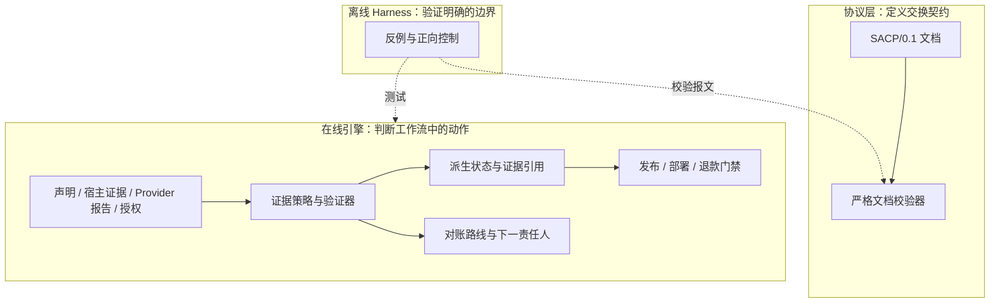

# SACP — AI Agent 完成声明核验

**Agent 说“完成了”，你的工作流该继续吗？**

SACP（Scalable Audit and Control Protocol）把完成条件写清楚：Agent 声称了什么、哪些证据支持声明、外部系统报告了什么，以及谁授权下一步动作。Python 参考引擎据此派生判定，再由领域 gate 决定是否允许继续。

**Experimental alpha：**提供交换协议、可执行参考引擎与可复现示例。可信证据采集仍由接入方负责。

[English](./README.md) · [快速上手](#快速上手) · [框架](#框架) · [PR 实践](#项目如何验证自己的-pr) · [示例导航](./examples/README.zh-CN.md)

## 在哪些地方有用

Agent 工作流经常跨越这样的边界：看起来相近的结果，实际含义不同。

| 交接时的说法 | 还需要检查什么 |
|---|---|
| “测试通过，可以发布了。” | 测试和产物是否对应这次 commit？当前输入是否获得批准？ |
| “部署请求已受理。” | Provider 是否报告了同一次部署、同一 revision 的健康结果？ |
| “通知已经送达。” | 是否有匹配的交付证据？后续退信是否改变了结果？ |
| “请求超时，重试一下。” | 外部动作是否可能已经发生？由谁负责对账？ |

CI 提供执行结果，tracing 记录观察，工作流引擎管理进度。SACP 在这些交接处补充显式证据要求、完成规则和恢复责任。当本地执行、外部完成与授权不一致时，这一层最有价值。

## 一个完整案例：发布预检

Agent 准备发布一个版本。Gate 将测试证据、产物身份和批准放在一起检查：

| 提供的证据 | Gate 结果 | 原因 |
|---|---|---|
| CI 通过、产物匹配，但没有批准 | 阻止 | 动作尚未获得授权 |
| 相同证据，加上匹配且有效的批准 | 允许预检通过 | 证据和授权满足发布策略 |
| 有批准，但产物来自另一个 commit | 阻止 | 证据不支持这次发布 |

允许结果表示预检契约通过；实际发布仍由调用方执行。

## 快速上手

使用 Python **3.11 或 3.12**，用本地 fixture 跑上面的案例：

```bash
git clone https://github.com/aDragon0707/sacp.git
cd sacp
python -m pip install -r requirements-ci.txt
python -m examples.github_release_gate
```

三种情况依次输出 `allowed=False`、`allowed=True`、`allowed=False`。示例不请求 GitHub，也不发布任何内容。

再查看失败边界和合法成功的正向控制：

```bash
python -m sacp_harness
```

```text
Breaker cases blocked: 8/8; false-success allowed: 0
...
Positive controls passed: 3/3

## Protocol validator: 49/49 strict PASS (0 FAIL)
```

Harness 使用固定合成场景，不调用模型。默认只打印，显式传入 `--output-dir .local/harness` 才写报告。接着按[示例导航](./examples/README.zh-CN.md)体验部署、退款、恢复和可选 LangGraph demo。

## 框架

主链路是 **Claim → Evidence → Verdict → Gate（声明 → 证据 → 判定 → 门禁）**，由三层配合实现与验证：



引擎分别记录声明、宿主观察、Provider 观察和授权决定，通过追加式 SQLite API 保存事件。新证据可以改变当前派生状态，历史记录继续保留。对账模块记录有界恢复路线，交给调用方执行。

运行时 `DerivedReceipt` 是 Python 投影；`SACP/0.1` receipt 则是独立的交换文档，CI builder 会为仓库检查生成后者。文档合法、动作获批，都不能单独证明外部动作已经成功。

组件职责参见[架构说明](./docs/architecture.md)，身份关联、授权和恢复规则参见[运行时契约](./docs/runtime-contracts.md)。

## 项目如何验证自己的 PR

本仓库把基于证据的审查流程用于自己的 PR：

```text
PR 代码 → 只读 CI → 证据 artifact
        → 默认分支上的可信实现核对 → 绑定 SHA 的 SACP receipt
        → 维护者审查 → 手动 squash merge → main 复验
```

可信 collector 在生成 receipt 前，独立核对 GitHub job 结果、当前 PR 身份和源码指纹。执行定义变化需要维护者专项引入审查。`COMPLETE / 200` 表示记录 SHA 的自动预检通过；语义审查与合并授权仍由维护者负责。

实际记录：[PR #22](https://github.com/aDragon0707/sacp/pull/22) 通过预检后被手动合并，[main 复验 38669974026](https://github.com/aDragon0707/sacp/actions/runs/38669974026) 随后在最终合并 commit [`48ba192`](https://github.com/aDragon0707/sacp/commit/48ba19209b7ea6f9d833193f92319cee0eed291a) 上通过。[验证记录](./docs/verification-2026-10-15.md)还覆盖了测试失败、PR 推送新 SHA、workflow 修改和协议审查提示。

## 选择接入入口

| 你的目标 | 从这里开始 |
|---|---|
| 理解或扩展交换契约 | [SACP/0.1 spec](./SPEC.md)、[receipt 格式](./RECEIPT.md) |
| 为工作流加入证据检查 | [示例导航](./examples/README.zh-CN.md)、[参考引擎](./sacp_verify/)、[LangGraph adapter](./sacp_verify/langgraph_adapter.py) |
| 判断发布、部署或退款条件 | [发布](./examples/github_release_gate.py)、[部署](./examples/deployment_verification.py)、[退款](./examples/refund_agent.py) |
| 审计已有回复或交接文本 | [AgentOps Doctor](./agentops-doctor-skill/)：本地启发式规则，不重新执行原任务 |
| 保留长任务交接状态 | [Receipt Chain](./SACP_RECEIPT_CHAIN.zh-CN.md)：可选审计 profile |

## 验证与当前边界

上述 main run 验证了 Ubuntu Python 3.11/3.12、Windows Python 3.12 各 100 项 core 测试，7 项 LangGraph 测试、49 份协议文档，以及 8 个 Harness 反例和 3 个正向控制，零失败、零错误、零 skip。这些检查存在重叠，属于有范围的回归证据，不能相加当作独立样本或生产准确率。`false-success allowed: 0` 仅适用于固定反例集合。

- **证据来源：**Python store 不认证写入者，payload adapter 依赖接入方提供可信采集与访问控制。
- **执行范围：**Provider 使用 mock 或 localhost 实验。调度、真实副作用、重试和补偿归调用方负责；没有托管服务或端到端 exactly-once 保证。
- **PR 信任：**业务代码与测试仍在同进程运行，语义审查不可省略；真实 fork 端到端覆盖未验证。未配置自动批准、修复或合并。

基础引擎使用 Python 标准库；协议与 CI 工具依赖 PyYAML，LangGraph 依赖显式的可选清单。完整边界见 [STATUS](./STATUS.md)、[验证范围](./docs/verification-2026-10-15.md)和 [ROADMAP](./ROADMAP.zh-CN.md)。

## 文档与贡献

- **理解项目：**[架构](./docs/architecture.md) · [证据模型](./docs/evidence-model.md) · [状态投影](./docs/state-machine.md)
- **运行与开发：**[示例](./examples/README.zh-CN.md) · [开发与 suite 命令](./docs/development.md) · [运行时契约](./docs/runtime-contracts.md)
- **审查与扩展：**[维护者流程](./docs/maintainer-workflow.md) · [Dirty Run cases](./DIRTY_RUN_CASES.md) · [贡献指南](./CONTRIBUTING.zh-CN.md)

欢迎提交可复现的假完成案例、合法成功却被误拦的案例、adapter contract test 或聚焦的文档修正。请附预期与实际结果、代码版本和最小复现步骤。提交示例前移除密钥、个人数据和专有日志。

## License

参见 [LICENSE](./LICENSE)。
