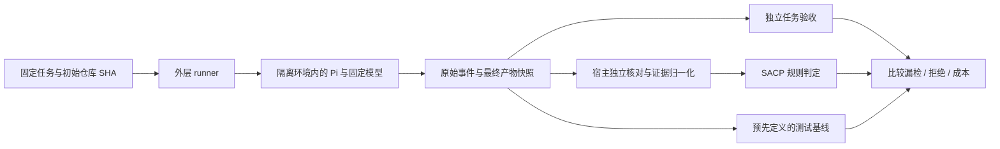

# ADR-0001：保留场景回归测试，以 Pi 试点真实 Agent 评测

当前 `sacp_harness/` 直接构造 Claim、mock provider 事件和授权，验证 SACP 引擎及协议文档；没有驱动真实 Agent 或调用模型。我们决定保留它作为确定性场景回归测试，另增真实 Agent 端到端评测层，并选择 Pi coding agent 作为首个有界接入试点，以回答 SACP 相比已有测试检查增加了什么判别价值。

本 ADR 最初接受的是架构方向和首个试点对象；当时 Pi adapter、执行环境、任务集和评测结果均尚未实现。后续进展独立记录于文末，保留以下原始决策与源码证据边界。

## 决策与术语

1. **保留现有场景回归测试。** `python -m sacp_harness` 的接口、8 个固定反例、3 个正向控制及现有 CI 契约继续保留，不改名目录，也不把模型调用引入 required PR jobs。
2. **新增独立的真实 Agent 评测层。** 先覆盖代码修复的小任务；实际执行与已保存轨迹的离线回放分开。真实调用是显式启动、有预算的实验，不能通过普通 CI 或导入模块自动发生。
3. **Pi 是首个 Agent 运行框架，不是模型或验收器。** 必须另外记录具体 provider、model、推理设置与工具配置；结果归属于该组合及任务集，不泛化为所有 Agent。
4. **Python 外层以 Pi JSON 模式子进程为首版接缝。** 一次任务一次进程，采集 JSONL、stderr、退出原因与产物。暂不引入 TypeScript SDK；需要交互控制时再评估 RPC。
5. **SACP 是被评估的判定层。** 独立任务验收器提供对照依据，不能用 SACP 自己的投影结果生成标准答案。Pi 的工具结果也只是待核对的执行记录。

术语定义见 [GLOSSARY](../../GLOSSARY.md)。Pi 官方使用的 “agent harness” 与本项目拟建的 “evaluation harness” 是不同角色。

## 为什么先选 Pi

2026-10-15，GitHub API 将旧 `badlogic/pi-mono` 地址重定向到 [`earendil-works/pi`](https://github.com/earendil-works/pi)。本次检查固定于源码 commit [`b06c1f2`](https://github.com/earendil-works/pi/tree/b06c1f2cf1dea6af8748ddeee18c23587d2cb7c6)，不把浮动 main 当作长期接口保证。

| 已核对能力 | 对本项目的意义 |
|---|---|
| MIT 许可、可读源码 | 能审查事件和工具语义，保留版本化接入依据 |
| JSON 模式执行一次任务并输出 JSONL | 适合当前 Python 外层采集，首版不需要交互式终端自动化 |
| RPC 与 TypeScript SDK 可选 | 后续若需要控制或嵌入，仍有明确接缝 |
| message、tool execution、retry、settled 等事件 | 能记录真实调用过程及失败阶段，而非只保存最终回复 |
| 可配置模型、工具、会话与扩展 | 有条件固定实验配置，减少个人环境污染 |

检查的 `package.json` 标识包名 `@earendil-works/pi-coding-agent`、源码版本 `1.2.0`、Node.js `>=22.19.0`。这不是本项目已安装该版本或已验证 npm 发布产物的声明。实际试点必须锁定安装版本、依赖锁/完整性与事件契约。

选择 Pi 的理由是可观察和易接入，不是已有证据表明它的任务成功率优于其他 Agent。

### 实施进展：2026-10-15，无模型接入阶段

新增 `sacp_eval/`：JSON 事件解析、默认拒绝模型执行的子进程采集 API、独立源码 fixture 验收与 SACP 证据绑定。本机已安装的 Pi 1.0.0 通过 `--version` / RPC `get_state` 探测，未发送 prompt、未继承模型凭据；这不代表原始审查的 1.2.0 版本已安装或完整运行时已锁定。RPC 此处只用于状态探测，任务执行接缝仍为 JSON subprocess。

合成轨迹与真实测试子进程已能区分正确/错误交付，并阻止旧源码证据复用；没有真实模型轨迹或效果指标。强制隔离、provider/model、预算和完整环境锁定尚未落实。用户明确要求先完成接入、暂不调用模型，因此完整真实 Agent pilot 仍待后续授权和环境准备。用法、接口与信任边界见[Pi 接入指南](../pi-integration.md)。

## 边界与执行流程

- **固定输入：**任务说明、初始 SHA、可改路径、预置测试与隐藏验收条件先确定。Agent 不可修改外层 runner、验收器和证据存储；新增测试可作为交付，但不可替换固定验收。
- **固定配置：**记录 Pi 和 Node 版本、provider/model ID、推理与生成设置、提示词/资源摘要、工具清单、依赖和执行环境。无法固定的随机性与 provider 版本漂移如实记录，不承诺逐字重现。
- **隔离外部影响：**将 Pi 及其工具放入明确的 OS/container/VM 边界；普通 worktree、子进程、工作目录和工具 allowlist 本身不构成沙箱。仅暴露任务所需文件和模型访问；禁止继承个人插件、MCP、配置、GitHub token 或其他无关凭据。模型凭据通过受控边界提供，不进入任务文件、命令参数或公开日志。
- **采集生命周期：**按 LF 解析 JSONL，以 toolCallId 关联工具事件，分别保存 stderr 与进程退出原因。不能把 RPC prompt 受理、`agent_end`、`agent_settled` 或 exit 0 单独当作任务完成；显式处理中止、provider error、超时、输出截断和进程异常。JSON 模式首版须核对 settled、流完整性与进程结束，之后仍执行独立验收。
- **独立取证：**在运行结束后的固定快照上，由外层计算 patch/文件摘要，并从隔离的干净初始环境重建依赖、应用补丁、执行固定验收。记录测试身份、选择范围、collection/setup/断言阶段、exit code、skip 与产物；不能只相信 Agent 声称运行过测试或复用其可污染环境。
- **分离结果：**分别记录任务成功/失败/不可判定、完成声明的支持情况、SACP 预检结果和运行基础设施状态。自然语言声明的提取与歧义处置要版本化，并保留人工复核；不能把所有失败归因给 Agent，也不能默认任何最终回复都声称全部完成。
- **协议兼容：**优先映射现有 `tests_passed`、`artifact_built` 等已支持策略；未知 claim 保持 unverified。先用有类型的实验记录保存评测结果；若输出 SACP/0.1 receipt，须 strict 校验，实验元数据放 extensions，不凭本 ADR 新增核心字段或弱化政策。

## 最小试点与验收

首轮建议 10–20 个固定小任务，只作为探索试点。先锁定一个 Pi/模型组合，不先建设多 Agent 平台；具体 provider/model、真实运行预算与执行环境尚未选择。本 ADR 不授权付费调用、上传会话、自动发布或实际执行业务副作用。

| 阶段 | 必须交付的证据 | 停止条件 |
|---|---|---|
| 接入 spike | 固定运行时与事件样例；正常结束、工具错误、provider 错误、超时/中止的采集；隔离与凭据边界验证 | 生命周期不明、无法限制环境或无法可靠保存事件时，不开始批量真实运行 |
| 任务/验收准备 | 至少一个已知有效补丁和一个失败交付，证明独立验收可区分两者；任务与测试预先冻结 | 验收器无法区分或证据不足时，标不可判定并修复验收，不调 SACP 结果凑通过 |
| 真实试点 | 每次实际运行的配置、原始轨迹摘要、patch、固定验收、声明判定与 SACP 输出 | 达到预置预算或时间上限即停止，保留失败和不完整记录 |
| 离线复核 | 同一批轨迹上的 baseline 与 SACP 比较，可重放的证据和人工歧义裁决 | 不足以证明增量价值时报告无增益或证据不足，不发布总体优越性结论 |

受控故障（例如错误测试选择或中断）应明确标注，与自然发生的真实失败分别报告；不能诱导虚报后当成 Agent 自然错误率。只有 fixture/mock 数据的 spike 不算真实 Agent 试点完成。

## 比较口径

先定义“固定测试退出状态＋执行范围”的基线，与 SACP 在同一批保存轨迹上比较，不能只选“完全相信最终回复”作为薄弱对照。公开任务数、运行数和 claim 数，各指标使用明确分母：

- 任务验收成功率与不可判定比例；完成声明的支持/不支持/歧义数量。
- 对预先定义的“不应放行”案例，SACP 与 baseline 各放行多少；报告漏检具体实例。
- 对验收成功且满足指定证据/授权契约的案例，各误拦多少。验收成功但缺少必需证据的保守阻止单独列出，不能直接算规则 bug，也不能隐藏其使用成本。
- 耗时、工具调用数、外层验证开销，以及 provider 实际提供的 token/费用字段。缺失费用填 unknown，不猜金额。

同轨迹离线比较能说明判定差异，不能证明在线接入让 Agent 任务成功率提高。若所有案例判断相同，就报告当前试点未观察到增量价值；不能事后挑选任务或修改 oracle 制造优势。

## 备选方案与代价

| 方案 | 取舍 |
|---|---|
| 只保留现有场景测试 | 快速稳定，但不能回答真实 Agent 上的漏检、误拦和接入成本 |
| 用模型运行替换所有场景测试 | 丢失确定性规则回归，给普通 CI 引入成本与波动，因此不采用 |
| 直接从多 Agent、大 benchmark 起步 | 归因与环境变量过多；首版推迟，后续按具体缺口再扩展 |
| Pi SDK 直接嵌入 | 可深度控制，但当前 Python 项目会增加 Node/TypeScript 耦合；首版选择 JSON 子进程 |
| Pi RPC 首版接入 | 适合持续会话与交互控制；首版单任务一进程优先简化，保留后续选择 |

代价是新增 Node 运行时、模型服务依赖、轨迹隐私治理和独立验收维护。普通 PR CI 继续只运行确定性检查，已脱敏且许可允许的固定轨迹可用于以后离线回归；公开原始会话须另行批准。Pi 更换事件契约、无法隔离、或无法稳定采集时，重新审议接缝或 Agent 选择，不把 SACP 核心绑定到 Pi 私有字段。

## 官方依据

以下均为本次读取的固定源码版本，不是安装或真实执行证明：

- [项目 README](https://github.com/earendil-works/pi/blob/b06c1f2cf1dea6af8748ddeee18c23587d2cb7c6/packages/coding-agent/README.md) 与 [package.json](https://github.com/earendil-works/pi/blob/b06c1f2cf1dea6af8748ddeee18c23587d2cb7c6/packages/coding-agent/package.json)
- [CLI](https://github.com/earendil-works/pi/blob/b06c1f2cf1dea6af8748ddeee18c23587d2cb7c6/packages/coding-agent/docs/cli.md)、[JSON events](https://github.com/earendil-works/pi/blob/b06c1f2cf1dea6af8748ddeee18c23587d2cb7c6/packages/coding-agent/docs/json.md)、[RPC](https://github.com/earendil-works/pi/blob/b06c1f2cf1dea6af8748ddeee18c23587d2cb7c6/packages/coding-agent/docs/rpc.md)
- [Security](https://github.com/earendil-works/pi/blob/b06c1f2cf1dea6af8748ddeee18c23587d2cb7c6/packages/coding-agent/docs/security.md) 与 [Environment variables](https://github.com/earendil-works/pi/blob/b06c1f2cf1dea6af8748ddeee18c23587d2cb7c6/packages/coding-agent/docs/environment-variables.md)
