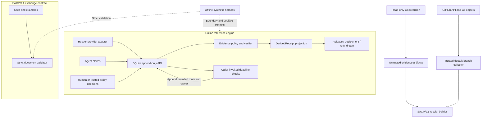

# SACP architecture

SACP asks one question at a handoff: **what evidence supports the completion claim, and who may authorize the next action?** It is an experimental protocol plus a Python reference engine, not a hosted control plane.

Read [README](../README.md) first, then this document, then the [maintainer workflow](./maintainer-workflow.md). Use [runtime contracts](./runtime-contracts.md) for exact behavior and migration boundaries.

## Three layers



The protocol is storage- and transport-independent. The reference engine uses SQLite as an implementation choice. Its localhost HTTP provider experiments do not constitute a public SACP HTTP API.

| Component | Owns | Does not establish |
|---|---|---|
| `validator.py`, protocol documents | Packet shape and supported semantic checks | That a claimed task actually happened |
| `sacp_verify/model.py`, `store.py` | Typed events, ordered persistence, deduplication | Writer authentication or database tamper resistance |
| `policy.py`, `verifier.py`, `lifecycle.py` | Claim evidence, authority binding, active provider execution, derived state | Authenticity of caller-supplied observations |
| `gate.py`, `deployment.py`, `refund.py` | Domain-specific allow/block decisions | Deployment execution, money movement, or general correctness |
| `reconciler.py` | Due absence checks, bounded route and next owner | A scheduler, provider query, retry or compensation executor |
| GitHub / LangGraph / CLI adapters | Payload mapping and workflow seams | A universal trusted collector |
| `sacp_harness/`, `tests/` | Reproducible controls over explicit fixtures | Population accuracy, production outcomes or independent product benchmarks |

## Four inputs, one projection

`Claim` records what the agent says. `HostObservation` records execution or artifact evidence. `ProviderObservation` records an external system's report. `AuthorityDecision` records permission for a particular input and scope.

The source roles are integration obligations. The Python store exposes all write methods to its caller, so merely constructing a provider observation does not authenticate a provider. An integration must restrict writers and authenticate collection outside this library.

The verifier returns `DerivedReceipt`, a Python projection with `host_status`, `authority_status`, `external_status` and `overall_status`. It also returns evidence references and recovery ownership. It never updates the historical rows. This object is different from a `SACP/0.1` wire receipt, which `scripts/build_ci_receipt.py` constructs and strictly validates separately.

Evidence references must identify the right event kind and execution context. Supported claim policies additionally check content, including commit identity where specified. Unknown claim types remain unverified. Approval binds thread, run, checkpoint, input digest, action scope and expiry; it does not imply the authorized action succeeded.

## A complete example

```text
agent: tests passed for commit C
host: successful CI observation for C + artifact digest for C
verifier: referenced evidence matches
authority: release scope approved for this input and checkpoint
release gate: preflight allowed
provider: request accepted under receipt R
verifier: transport_accepted, not delivered
provider: matching terminal observation for R
domain gate: completion conditions satisfied
```

For deployment, finalization requires matching acceptance and health on provider, deployment ID and revision. For refunds, it requires matching order, amount, currency, provider, refund ID and current authorization. Within one execution, failure dominates success. A new accepted attempt can be evaluated separately without deleting the old failure.

The observation-only deployment health gate remains available. `can_dispatch` is the explicit authorization check before execution; authority-required claims enforce approval during finalization too. Full integration must place that check before the real side effect, rather than treating a later healthy result as permission.

## Online engine and offline evaluation

The engine runs during a workflow to derive state and gate actions. The harness runs offline against fixed synthetic scenarios. Its eight breakers exercise missing evidence, deployment acceptance without health, transport acceptance without delivery, delivery followed by bounce, missing witness, stale approval, mock retry identity, and self-attestation. Three positive controls check that valid delivery, health and an authorized mock refund can succeed.

Additional tests cover cross-receipt identity, callback permutations, approval revocation, SQLite restart/concurrency, and accepted-but-not-terminal reconciliation. These tests do not establish a real-world error rate. The harness's trace column is explanatory text, not a measurement of tracing systems.

## Why another layer?

CI can establish that a particular job executed successfully. Tracing records the path and observations. A workflow engine persists execution progress. SACP makes the claim, required evidence, domain completion condition, authorization and next owner explicit at a handoff. If a task is already fully described by one existing CI check, another layer can add little benefit.

The engineering value is strongest where “accepted”, “executed”, “delivered”, “healthy” and “authorized” differ. SQLite transactions protect local decisions and mock reservations; they cannot make a remote side effect exactly-once. Timeouts produce an owned uncertainty/recovery route, not fabricated success or a blind resend.

## Current limits

There is no authenticated general event gateway, production deployment, payment execution, managed scheduler or hosted service. PR receipts independently check GitHub facts and source identity, but malicious application code and tests still share a process. Automation changes require human review and sometimes bootstrap acceptance. See [verification scope](./verification-2026-10-15.md), [STATUS](../STATUS.md) and [ROADMAP](../ROADMAP.md).
