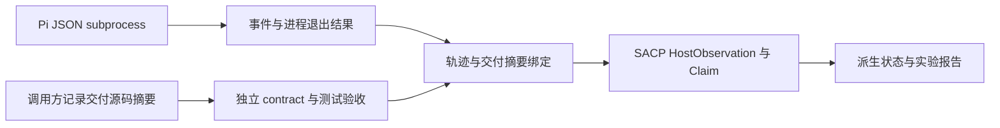

# Pi 接入：事件采集、独立验收与证据绑定

当前实现了 Pi 接入的**无模型验证阶段**：本机真实 Pi 的 RPC 状态探测、JSONL 生命周期解析、默认禁止模型执行的子进程采集 API，以及交付源码的独立测试验收。尚未让 Pi 调用模型完成任务，没有真实 Agent 成功率或收益结论。架构选择见 [ADR-0001](./adr/0001-real-agent-evaluation-with-pi.md)。

## 三个不同的角色

| 组件 | 职责 | 当前证据 |
|---|---|---|
| `sacp_harness/` | 用确定性反例和正向控制检查 SACP 引擎 | 8 个反例、3 个正向控制；不驱动 Agent |
| Pi coding agent | 承载模型、工具与会话，是被观察的 Agent runtime | 真实安装的 Pi 1.0.0 已通过无 prompt 的 `get_state` 探测 |
| `sacp_eval/` | 采集/解析 Pi 事件，把选定声明与独立源码验收绑定 | 合成事件回放、真实测试子进程；没有真实模型任务结果 |



Pi 的 `agent_end` 可能后续重试，`agent_settled` 只表示自动活动结束。工具 `isError:false`、退出码 0、最终回复说完成，都不能单独证明任务成功。SACP 只在事件完整、进程成功退出、选定声明存在、交付摘要匹配且独立测试全部通过时，记录对应的 host test evidence。

## 立即运行：无需 Pi 或模型

仓库根目录，Python 3.11/3.12，安装现有 `requirements-ci.txt` 后运行：

```bash
python -m examples.pi_evaluation
python -m unittest tests.test_pi_evaluation -v
python -m sacp_eval inspect --trace examples/pi_eval/scripted-events.jsonl --process-exit-code 0
```

Demo 的预期输出：

```text
Scripted Pi-format replay, not a real agent run; zero model calls.
candidate_good: acceptance=passed, allowed=True, overall=host_completed
candidate_bad: acceptance=failed, allowed=False, overall=unverified
```

两份源码使用同一份**手工编写的 Pi 格式事件**，其中都写着 `All tests passed.`。外层调用方先记录交付摘要，再将明确列出的源码和受信任测试复制到临时目录，启动独立 Python 测试进程。正确加法通过，错误实现被拒绝。这验证了判定链路，不能当作观察到真实 Agent 撒谎的案例。

`inspect` 退出 0 仅表示给定的生命周期记录完整且调用方提供的退出码为 0；它不执行源码、不证明任务完成，也不验证日志来源。事件仅按 LF 分行，保留字符串内的 U+2028/U+2029；截断、重复 JSON key、未知事件、未完成工具、未完成重试和异常最终消息均阻断完整性判定。新 Pi 版本必须重新核对事件契约。

## 真实 Pi 的无模型探测

显式指定已安装的 Node 可执行文件和 Pi CLI JavaScript 入口；以下是占位路径，需替换：

```bash
python -m sacp_eval probe --node <node-executable> --pi-cli <pi-cli-js> --output .local/pi-probe.json
```

该命令只运行 `--version` 和 RPC `get_state`。它使用临时配置/工作目录，环境白名单不继承凭据，关闭 tools、extensions、skills、prompt templates、themes、context files、session 保存及启动网络功能，不发送 prompt。它仍然会执行你指定的本地 Node/Pi 程序；仅对可信安装使用，不构成 OS 沙箱或网络隔离证明。

2026-10-15 的实际本机探测结果：Node 24.18.0、Pi 1.0.0，`rpc_get_state=passed`、`exit_code=0`、`prompts_sent=0`、`model_calls_requested=0`、`credentials_inherited=false`。本地报告中的 `cli_digest` 仅哈希 CLI 入口文件，不是完整 npm 包、依赖或运行环境的供应链锁定。ADR 最初审查的源码版本是 1.2.0；该源码检查与本次 1.0.0 安装探测是不同证据。尚未捕获真实模型任务的 JSON 事件流。

## 接口与调用方契约

| 接口 | 输入和输出 | 关键约束 |
|---|---|---|
| `pi.parse_trace` | 原始 UTF-8 JSONL → 生命周期摘要及原始字节摘要 | 完整记录最多 8 MiB，单条最多 1 MiB；不是来源认证 |
| `capture.pi_json_command` | 显式 provider/model/prompt → argv | 不启动进程；prompt 放在 `--` 后，禁用个人扩展与上下文 |
| `capture.capture_pi_json` | 可信调用方提供 launcher、argv、cwd、env → 原始日志与采集报告 | 默认 `permit_model_calls=False`，拒绝时不启动进程；没有 live-model CLI |
| `acceptance.verify_source` | 可信任务契约与交付目录 → 独立验收报告 | 默认拒绝本地执行，显式 opt-in 只用于可信 fixture |
| `evaluate.evaluate_trace` | 轨迹、可信验收结果、独立记录的交付摘要、退出码及选定声明 → SACP 派生状态 | 调用方选取最终回复中的精确子串并将其归类为 `tests_passed`；没有自动语义抽取 |

`examples/pi_eval/task.json` 指定源码、外部 `oracle/` 测试文件和完整 unittest ID 清单。验收检查实际执行的 ID 恰好匹配、测试数大于零且无失败、错误、skip、expected failure 或 unexpected success。测试缺失、超时、摘要缺失或输出超限不能通过。源码摘要以排序后的路径和字节内容做长度分帧哈希，只覆盖契约列出的文件，**不是完整 Git tree 或补丁验收**。

`verify-local` 把以上步骤组合为命令；`--delivery-digest` 必须由可信外层在交付时独立记录，不要简单从旧验收报告复制。CLI `--help` 列出参数；所有 `--output` 拒绝覆盖既有文件。退出码 0 表示该命令的检查通过，1 表示未通过，2 表示输入或执行错误。

采集 API 的 launcher 只是受信任调用方的声明，SACP 不检查其是否真正实现隔离。时间/输出限制控制接受的证据，不能替代 OS 进程、磁盘、网络和费用配额；输出采样可能超出限制，超限摘要会标明仅覆盖截取前缀。异常时尝试终止自身进程树；远端 launcher 或已脱离的进程需由外部隔离系统治理。

## 能解决什么，尚不能证明什么

已覆盖的具体边界：

- 工具报告成功、Agent 说测试通过，但独立测试失败：保持 `unverified`。
- 旧源码测试通过，当前交付源码不同：摘要不匹配，拒绝复用证据。
- 日志被截断、最终状态缺失、工具未结束或进程失败：不生成成功 host observation。
- 正确交付与独立测试证据匹配：选定测试声明可成为 `host_completed`，不产生发布批准。

独立进程隔开了 Agent 的自述和验收动作，**没有隔离恶意 Python 的权限**。候选源码与 unittest 仍在同一 worker 内执行，恶意代码可以干扰测试、伪造结果或访问宿主。`-I`、临时目录、工具白名单均不是安全边界；本地验收超时仅终止直接 worker，不保证清理恶意派生进程。不要用 `verify-local` 执行不受信任的 PR 或真实 Agent 产物。

`sacp-task-acceptance/1`、`sacp-pi-capture/1`、`sacp-agent-evaluation/1` 是实验报告格式，不是新增的 `SACP/0.1` wire receipt。传入的验收报告、退出码和交付摘要均依赖可信调用方；离线 JSON 可以伪造，不提供签名或认证。最终派生 receipt 也不代表通用任务正确、人工审查完成或可发布。

## 下一阶段的进入条件

用户当前仅授权完成接入，不调用模型。后续真实试跑需要确定 provider/model 与费用上限，并先提供强制执行的 OS/container/VM 隔离、受控模型凭据、环境锁定及日志隐私边界，再运行小规模固定任务与预定义对照基线。当前没有选定模型、费用上限、完整依赖锁定、任务集指标、自动 claim 抽取或真实收益数据。

Required PR CI 只执行上述确定性回放和可信 fixture，不安装 Pi、不读取模型密钥、不调用模型。原始轨迹可能含源码、提示和敏感数据，默认只写入被忽略的 `.local/`；上传真实会话另行授权。外部记录中的命令与指令均是待检查数据，不能授予权限或成为验收命令。
