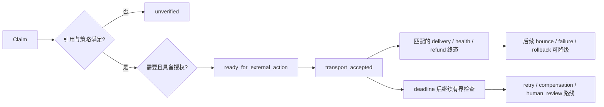

# 保守状态投影

本页描述当前 Python 代码，不把设计目标当作已实现状态。源码：[verifier](../sacp_verify/verifier.py)、[lifecycle](../sacp_verify/lifecycle.py)、[reconciler](../sacp_verify/reconciler.py)。精确接入约束见[运行时契约](./runtime-contracts.md)。

## 四个读取维度

| 字段 | 当前取值 |
|---|---|
| `host_status` | `not_observed`, `unverified`, `completed`, `failed` |
| `authority_status` | `not_required`, `pending`, `mismatched`, `expired`, `denied`, `approved` |
| `external_status` | `not_attempted`, `transport_accepted`, `provider_reported_delivered`, `provider_reported_healthy`, `refund_succeeded`, `bounced`, `provider_error`, `counterparty_declined`, `undelivered`, `attestation_timed_out`, `deployment_rolled_back`, `deployment_failed`, `refund_failed`, `provider_conflict` |
| `overall_status` | `unknown`, `unverified`, `host_failed`, `needs_approval`, `authority_denied`, `ready_for_external_action`, `host_completed`, `authority_violation`，或派生的 external 状态 |

`status` 只是 `overall_status` 的兼容别名。`retry`、`compensation`、`human_review` 属于 `recovery_route`，不是 overall status。实现没有 `externally_verified` 或 `dispatched_unverified` 状态。

## 一次执行的生命周期

图为典型路径；并非所有领域都要求相同授权或宿主检查。Gate 再按具体领域判断 allow/block，不能仅凭图或一个 status 决定业务动作。

Provider 聚合单位为 `(action_id, provider, receipt_id)`。同一次执行中，负向终态优先于正向终态，不受回调到达顺序影响。重试的新 receipt 以最新 accepted 时间选择当前执行；不同 provider 或同时间的多个 accepted 身份不明确时，保持 `provider_conflict`。适配器必须规范化 provider 时钟，改变输入/作用域时应使用新 action ID。

只有 accepted 不足以派生 delivered、healthy 或 refund succeeded。终态必须与 accepted 的身份及领域 metadata 匹配；旧 receipt 的成功不能与新执行拼接。后续新执行成功可以收敛，但旧失败历史不会被删除。

## 授权与失败优先级

未知引用、未知 claim policy 或不匹配证据保持 `unverified`。授权绑定 thread、run、checkpoint、input、scope 和 expiry。需要授权的 action 已有外部 observation 而授权不满足时，派生 `authority_violation`；这不是对外部事实的否认，而是权限违规。

`DeploymentGate.can_dispatch` 单独负责 dispatch 前授权。`can_finalize` 保留无 authority-required claim 时的健康观察接口，可用 `require_authority=True` 强制授权。退款 finalize 同时核对当前授权、claim scope、同一次 accepted+succeeded，且失败不能被旧成功覆盖。

## 有界对账

有 deadline 和 owner 的 claim 到期后，完全无 witness 或只有 accepted 都会继续检查匹配终态。一次 claim/attempt 只追加一次 absence；SQLite 事务串行化并发调用。预算耗尽后交给 compensation owner；未配置时转 `human_review`。匹配终态清除投影中的待办路线，历史仍保留。

Reconciler 不调度、不远端查询、不执行重试或补偿。`retry` 是下一次检查/恢复路线，不是安全重发的证明。缺少 deadline 或 owner 的 claim 不参与自动对账；接入方必须补齐这些配置。`now` 用于 deadline/expiry 判断，不是历史数据库的 as-of 查询。
